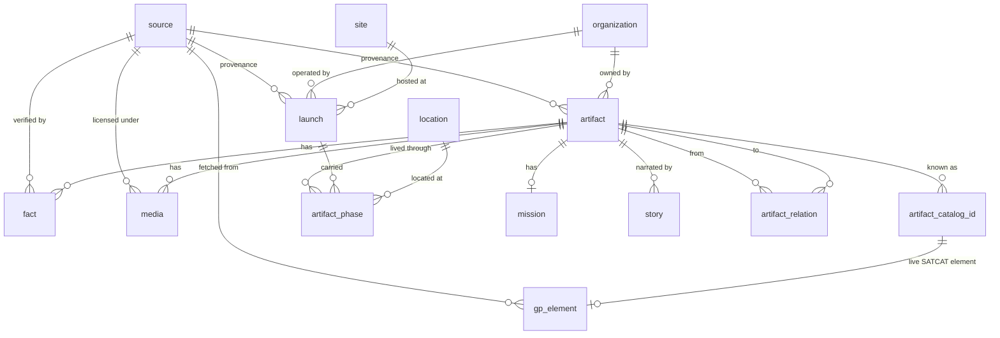

# Database design

PostgreSQL 16 is the system of record. The schema separates three things that
space catalogs usually flatten into one: **the physical object**, **the names
catalogs give it**, and **the phases of its life**.

Files:

| File | Purpose |
|---|---|
| `db/schema.sql` | Canonical tables, enums, indexes, triggers, read views |
| `db/staging.sql` | Raw GCAT TSV landing tables (text only, disposable) |
| `db/seed/001_lookups.sql` | Sources, SatType coarse codes, orbit categories, phase statuses |
| `db/queries/card.sql` | App card read model |
| `db/queries/lineage.sql` | Recursive parent/child traversal |
| `db/queries/live.sql` | Latest CelesTrak element set per artifact |

Apply order: `schema.sql` → `seed/001_lookups.sql` → `staging.sql`.

---

## 1. Why this shape

GCAT is **phase-based**. Each row is one catalog entry for one period in an
object's history, and the same physical object can be reassigned a new catalog
number when it crosses the deep-space boundary, lifts off from the Moon, or is
relaunched. A schema with `artifacts.jcat_id` as a permanent key cannot represent
that.

Three layers:

```text
artifact            physical thing, stable internal UUID
  ├─ artifact_catalog_id   external names: JCAT / SATCAT / COSPAR / Horizons
  └─ artifact_phase        one GCAT row: one state between two events
```

The graph is therefore real, but it does not need a graph server. Parent links
and curated relations are both edges, and recursive SQL walks them.

---

## 2. Entity map



---

## 3. Table reference

### Provenance

| Table | One row means | Rules |
|---|---|---|
| `source` | A data source and its license | `source_id` is stable (`gcat`, `celestrak`, …). `citation` is the exact line the UI must show. |
| `etl_run` | One ingestion job execution | Records release tag, row counts, status. Never delete; it is the audit trail. |

Every imported canonical row carries `source_id` and `source_row`. Rows without
provenance are curator-authored and point at `source_id = 'curated'`.

### Geography and operators

| Table | One row means | Rules |
|---|---|---|
| `organization` | GCAT OrgCode | Owner, state and manufacturer all resolve here. `org_type` and `org_class` are GCAT codes, not invented labels. |
| `site` | Launch site or platform | `parent_site_code` handles complexes and sub-sites. |
| `location` | A place a phase can be at | Surface site, impact site, orbit regime, Lagrange point, body. Holds GCAT lander coordinates. |

### Launch

| Table | One row means | Rules |
|---|---|---|
| `launch` | One GCAT `Launch_Tag` | `launch_id` is the GCAT tag (`1969-059`, `1969-U01`). Also stores the launch vehicle, pad, agency, outcome and initial orbit. |

`cospar_launch_id` is stored for display and joins, but the authoritative link
from a phase to a launch is `artifact_phase.launch_id` → `launch.launch_id`.

### Objects

| Table | One row means | Rules |
|---|---|---|
| `artifact` | A physical object | Internal UUID. `slug` is the stable public URL key. `primary_zone` is required for navigation. |
| `artifact_catalog_id` | One external identifier | Unique per `(artifact, scheme, value)`. At most one primary per scheme (partial unique index). Not unique across artifacts: one SATCAT can describe several GCAT objects. |
| `artifact_phase` | One GCAT catalog row | `jcat_id` is unique and belongs to the phase. `seq` orders phases. Dates are raw + normalised + precision + approximate flag. |
| `artifact_relation` | One curated edge | Explicit genealogy (`deployed_from`, `component_of`, …). `parent_ref_raw` is evidence; this table is the resolved answer. |

### Narrative

| Table | One row means | Rules |
|---|---|---|
| `mission` | Mission-level curated metadata | Program, class, category, discipline, result, plus the human-written `abandonment_reason`. |
| `fact` | One claim with a source | `fact_type` groups it. `source_url` points at the exact page. Curated only. |
| `media` | One image/video/audio asset | Licence and credit are mandatory. NASA assets keep their per-image credit. |
| `story` | One generated narration | Versioned by `prompt_version` and `fact_hash`, with `facts_snapshot` proving what the model saw. |

`story` is output only. Comparisons, quiz answers and fact panels must read
`fact` / `mission`, never `story`.

### Live tracking

| Table | One row means | Rules |
|---|---|---|
| `gp_element` | One CelesTrak OMM element set | Unique `(satcat_no, epoch)`. Positions are propagated on demand, never stored per second. |

---

## 4. Identity rules

### 4.1 JCAT is a phase key, not an object key

GCAT documents the Apollo 11 lunar module ascent stage as three catalog
identities:

| Event | Launch tag | JCAT | Why |
|---|---|---|---|
| Launched from Earth | `1969-059` | `S04041` | Normal Earth-orbit catalog entry |
| Crossed the deep-space boundary | `1969-059` | `D00274` | Status `DSO`; deep-space catalog takes over |
| Lifted off from the Moon | `1969-U01` | `D01052` | Status `LO`; new launch and catalog number |

The database stores **one artifact** and **three phases**, with all three JCAT
values in `artifact_catalog_id`.

### 4.2 SATCAT is not unique

A single SATCAT number can cover a payload, a stage and an attached experiment.
Analyst numbers are also reused. `satcat_no` therefore has a normal index, not a
unique constraint. The only unique key is `(artifact_id, scheme, value)`.

### 4.3 COSPAR is not a join key

Piece identifiers are usually `YYYY-NNNP`, but ISS-released objects and unusual
USSF designations break the prefix rule. Join phases to launches with GCAT's
`Launch_Tag`, and store the piece identifier as a display alias.

### 4.4 COSPAR and SATCAT values may be non-numeric

GCAT uses `NNA`, `NSO` and blank values. Anything that casts a catalog value to a
number must guard it (`value ~ '^[0-9]+$'`), as the card view does.

### 4.5 Identity resolution is a curation step

The ETL proposes groupings from `Satcat`, `Parent`, `Launch_Tag` and status
transitions (`DSO`, `DSA`, `LO`, `REFLT`). A human confirms them into
`artifact_phase` and `artifact_relation`. Never merge artifacts automatically on
name alone.

---

## 5. Dates: GCAT VagueDate

GCAT dates look like `1969 Jul 20`, `1969 Jul 20 2017`, `1969 Jul` or `1969`,
sometimes with a trailing `?`. Precision is real information and must survive.

Every date therefore has four columns:

| Column | Example | Meaning |
|---|---|---|
| `*_raw` | `1969 Jul 20 2017:33?` | Exact published string. Never rewritten. |
| `*_best` | `1969-07-20 20:17:33+00` | Best normalised value, UTC. |
| `*_precision` | `second` | `year` … `second`, or `unknown`. |
| `*_approx` | `true` | The source marked the value uncertain (`?`). |

Rules:

- Do not raise precision. A year-only date becomes `1969-01-01 00:00:00+00` with
  precision `year`, and the UI must render “1969”, not “1 January 1969”.
- A trailing `?` sets `*_approx`, and stays visible in `*_raw`.
- Never use `date_best` for ordering only; ordering may be wrong within a
  precision bucket (a month-only date sorts at the start of the month).

The same pattern applies to `launch.date_*`, `artifact_catalog_id.valid_*` and
`mission.tlast_*` / `top_*` / `tdate_*`.

---

## 6. Zones

`zone_kind` is the product's four-way navigation: `moon`, `mars`,
`earth_orbit`, `deep_space`, plus `other`.

Derivation order (first match wins):

| Zone | Rule |
|---|---|
| `moon` | Phase `primary_body = 'Moon'`, or a lander row with `world = 'Luna'` / `'Moon'`. Also cislunar (`CLO`) objects whose destination is the Moon. |
| `mars` | Phase `primary_body = 'Mars'`, or a lander row with `world = 'Mars'`. |
| `earth_orbit` | Phase `primary_body = 'Earth'` with an `op_orbit` in the bound Earth set: `LLEO/*`, `LEO/*`, `MEO`, `HEO`, `HEO/M`, `GTO`, `GEO/*`, `VHEO`. |
| `deep_space` | `op_orbit` in `DSO`, `EEO`, `HCO`, `SSE`; `primary_body` is the Sun or a body other than Earth/Moon/Mars; or a planetary flyby/escape. |
| `other` | Ambiguous or missing data. Must be resolved before an artifact is marked curated. |

`primary_zone` on `artifact` is the zone of the artifact's final/most
representative phase, chosen during curation. `artifact_phase.zone` keeps the
per-phase truth, so a Mars lander that was in Earth orbit during cruise can show
both.

---

## 7. Status and orbit vocabularies

`phase_status.code` is the GCAT `Status` value. The full set is seeded from the
GCAT definitions (`O`, `R`, `D`, `L`, `DSO`, `LO`, `REFLT`, `EO`, …). Keep the
raw code, and display `phase_status.description`.

`orbit_category.code` is GCAT's `OpOrbit` (`LLEO/I`, `GEO/S`, `CLO`, `HCO`, …).
The seed includes the published definitions. Do not invent new categories; add a
separate derived field if the UI needs friendlier buckets.

---

## 8. What GCAT does not answer

These are curated, with a source per claim, in `mission` / `fact`:

- why the object was abandoned
- power source
- distance driven
- crew notes and quotes
- emotional or narrative text
- “is this actually still there?”

GCAT gives mass, dimensions, owner, launch, phases, orbit, landing coordinates
and status. That is the deterministic backbone. Everything else is a cited fact.

---

## 9. Curation lifecycle

1. **Shortlist** — pick objects across all four zones; do not exhaust one zone.
2. **Resolve identity** — create `artifact`, add catalog aliases, create phases.
3. **Attach launch and location** — `launch_id`, `location_id`, coordinates.
4. **Enrich** — `mission` fields, `fact` rows with `source_url`.
5. **Add media** — `media` with licence and credit.
6. **Mark curated** — `artifact.is_curated = true` only when every zone claim and
   abandonment claim has a source.
7. **Generate story** — `story` keyed by `fact_hash`; regenerate when facts change.

---

## 10. Graph queries without a graph server

`v_artifact_edge` unions curated relations with resolved GCAT parent links.
`db/queries/lineage.sql` walks it with a recursive CTE and a cycle guard.

If Apache AGE is ever added, project from these tables — never write to the graph
as a second source of truth:

```cypher
MATCH (a:Artifact {slug: 'apollo-11-lunar-module-eagle'})
OPTIONAL MATCH path = (a)-[:DEPLOYED_FROM|SPAWNED_FROM|COMPONENT_OF*0..6]->(child)
RETURN path
```

The relational tables remain canonical, so the graph can always be rebuilt.
